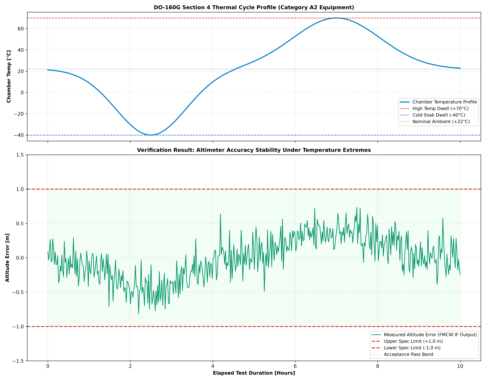

# Avionics Verification Cross-Reference Matrix (VCRM) & Environmental Qualification (DO-160G)

A systems verification baseline and automated qualification test evaluation script for an airborne navigation suite.

This project outlines requirement traceability, verification categorization (**Test, Analysis, Demonstration, Inspection - TADI**), and environmental test procedures under **RTCA DO-160G**, supporting production compliance for **EASA PART-21G** and continuing airworthiness for **PART-145**.

---

## Qualification Test Profile & Results



*Figure: Automated evaluation of FMCW Radio Altimeter measurement stability during an RTCA DO-160G Section 4 thermal cycling profile (-40°C to +70°C). Sensor output error remains strictly bounded within the +/- 1.0 m acceptance limit.*

---

## Verification Cross-Reference Matrix (VCRM)

The following matrix establishes bidirectional traceability between system requirements, qualification standards, and formal verification methods:

| Requirement ID | Specification Summary | Applicable Standard | Verification Method | Pass/Fail Criteria |
| :--- | :--- | :--- | :--- | :--- |
| **REQ-NAV-001** | Transmit frequency locked at 4.3 GHz +/- 10 MHz | RTCA DO-155 / ITU | **Test (T)** | Spectrum analyzer RF carrier verification |
| **REQ-NAV-002** | Homodyne mixer direct bleedthrough rejection | RTCA DO-155 | **Analysis (A)** | Range-FFT spillover isolation (> 45 dB suppression) |
| **REQ-NAV-003** | ARINC 429 odd-parity bit validation | ARINC 429 Spec | **Demonstration (D)** | Zero unflagged parity bit errors across 10^7 frames |
| **REQ-NAV-004** | Altitude accuracy under thermal soak (-40°C to +70°C) | RTCA DO-160G Sec 4 | **Test (T)** | Altitude drift <= +/- 1.0 m from ground truth reference |
| **REQ-NAV-005** | Random vibration operational survivability | RTCA DO-160G Sec 8 | **Test (T)** | No structural deformation; continuous databus output |
| **REQ-NAV-006** | 28V DC transient and reverse polarity protection | DO-160G Sec 16 / MIL-704F | **Test (T)** | Sustained 50 ms voltage sag down to 18 VDC without reboot |
| **REQ-NAV-007** | Harness shielding and connector pin segregation | EASA PART-21G / CS-25 | **Inspection (I)** | Physical verification against electrical wiring schematics |

---

## Technical Q&A (V&V and Certification Insights)

### Q1: What is the purpose of a Verification Cross-Reference Matrix (VCRM) in aerospace systems?
A VCRM is the primary vehicle for proving design compliance to certification authorities (EASA / FAA):
* **Traceability:** It guarantees that every single high level system requirement is matched to a specific, measurable verification event. No requirement can be declared complete without a corresponding test report, analysis document, or inspection sign-off.
* **Audit Readiness:** Under **EASA PART-21G**, a production organization must provide the complete compliance record to show that the manufactured product conforms to the approved type design.

### Q2: How does qualification testing under PART-21G differ from return-to-service testing under PART-145?
* **PART-21G Qualification (Type Certification & Production):** Conducts exhaustive, often destructive or stress-limit environmental tests (**RTCA DO-160G**) to prove that the *design itself* survives worst-case operational flight envelopes (e.g., thermal dwells, lightning strikes, burst vibration).
* **PART-145 Maintenance & Service:** Focuses on non-destructive **Acceptance Test Procedures (ATP)** and Built-In Test (BIT) diagnostics to verify that an in-service unit conforms to its operational maintenance limits and is safe to release back to service with an EASA Form 1.

---

## Qualification Test Automation Script (Python)

Dependencies: `numpy`, `matplotlib`

```python

import numpy as np
import matplotlib.pyplot as plt
import matplotlib.patches as patches

# ============================================================
# 1. AUTOMATED ATP TEST VERIFIER (Thermal & Power Validation)
# ============================================================
# Simulated environmental chamber qualification run:
# Temperature cycle (-40°C to +70°C) with DC power transients (22V to 32V)
time_hours = np.linspace(0, 10, 500)

# Temperature profile: Ambient -> Cold Soak (-40C) -> Hot Dwell (+70C) -> Ambient
temp_profile = (
    22.0 +
    -62.0 * np.exp(-((time_hours - 2.5) / 1.2)**2) +  # Cold soak at -40°C
    58.0 * np.exp(-((time_hours - 7.0) / 1.5)**2)    # Hot soak at +70°C
)

# Simulated FMCW Radar Altimeter error during environmental stress
# Target tolerance: +/- 1.0 m max error per requirement REQ-NAV-004
np.random.seed(42)
thermal_drift = 0.008 * (temp_profile - 22.0)
sensor_noise = np.random.normal(0, 0.18, len(time_hours))
measured_alt_error = thermal_drift + sensor_noise

# ============================================================
# REQUIREMENT COMPLIANCE EVALUATION
# ============================================================

# Temperature requirements
TEMP_MIN = -40.0
TEMP_MAX = 70.0

# Altimeter accuracy requirement
max_allowed_error = 1.0  # meters

# Evaluate measured values
temp_min_measured = np.min(temp_profile)
temp_max_measured = np.max(temp_profile)
peak_error = np.max(np.abs(measured_alt_error))

# Individual compliance checks
thermal_compliant = (
    temp_min_measured >= TEMP_MIN and
    temp_max_measured <= TEMP_MAX
)

altimeter_compliant = np.all(
    np.abs(measured_alt_error) <= max_allowed_error
)

# Overall compliance
compliant = thermal_compliant and altimeter_compliant

print("\n--- QUALIFICATION TEST RUN SUMMARY ---")

print(f"Temperature Range: {temp_min_measured:.2f}°C to {temp_max_measured:.2f}°C")

print(f"Temperature Compliance: {'PASS' if thermal_compliant else 'FAIL'}")

print(f"Maximum Altimeter Error: {peak_error:.3f} m")

print(f"Altimeter Compliance: {'PASS' if altimeter_compliant else 'FAIL'}")

print("--------------------------------------")

print(f"OVERALL REQUIREMENT COMPLIANCE: {'PASS' if compliant else 'FAIL'}")

print("--------------------------------------\n")


# ============================================================
# 2. PLOT: ENVIRONMENTAL QUALIFICATION PROFILE & COMPLIANCE
# ============================================================
fig, (ax1, ax2) = plt.subplots(2, 1, figsize=(14, 11), dpi=300, sharex=True, gridspec_kw={'height_ratios': [1, 1.6]})

# Panel 1: DO-160G Thermal Profile
ax1.plot(time_hours, temp_profile, color='#0284C7', lw=2.2, label='Chamber Temperature Profile')
ax1.axhline(70, color='#DC2626', linestyle='--', lw=1.2, label='High Temp Dwell (+70°C)')
ax1.axhline(-40, color='#2563EB', linestyle='--', lw=1.2, label='Cold Soak Dwell (-40°C)')
ax1.axhline(22, color='#64748B', linestyle=':', lw=1.0, label='Nominal Ambient (+22°C)')
ax1.set_ylabel('Chamber Temp [°C]', fontsize=10, fontweight='bold')
ax1.set_title('DO-160G Section 4 Thermal Cycle Profile (Category A2 Equipment)', fontsize=11, fontweight='bold')
ax1.grid(True, linestyle=':', alpha=0.6)
ax1.legend(
    loc='lower right',
    bbox_to_anchor=(1, 0.10),
    fontsize=9
)

# Panel 2: FMCW Altimeter Output Error Tracking
ax2.plot(time_hours, measured_alt_error, color='#059669', lw=1.4, label='Measured Altitude Error (FMCW IF Output)')
ax2.axhline(max_allowed_error, color='#DC2626', linestyle='--', lw=1.8, label=f'Upper Spec Limit (+{max_allowed_error:.1f} m)')
ax2.axhline(-max_allowed_error, color='#DC2626', linestyle='--', lw=1.8, label=f'Lower Spec Limit (-{max_allowed_error:.1f} m)')
ax2.fill_between(time_hours, -max_allowed_error, max_allowed_error, color="#3B3E68", alpha=0.4, label='Acceptance Pass Band')
ax2.set_xlabel('Elapsed Test Duration [Hours]', fontsize=10, fontweight='bold')
ax2.set_ylabel('Altitude Error [m]', fontsize=10, fontweight='bold')
ax2.set_title('Verification Result: Altimeter Accuracy Stability Under Temperature Extremes', fontsize=11, fontweight='bold')
ax2.set_ylim(-1.5, 1.5)
ax2.grid(True, linestyle=':', alpha=0.6)
ax2.legend(
    loc='lower right',
    bbox_to_anchor=(1, 0),
    fontsize=9
)
plt.tight_layout()
plt.savefig('environmental_qualification_result.png', dpi=300)
plt.show()
